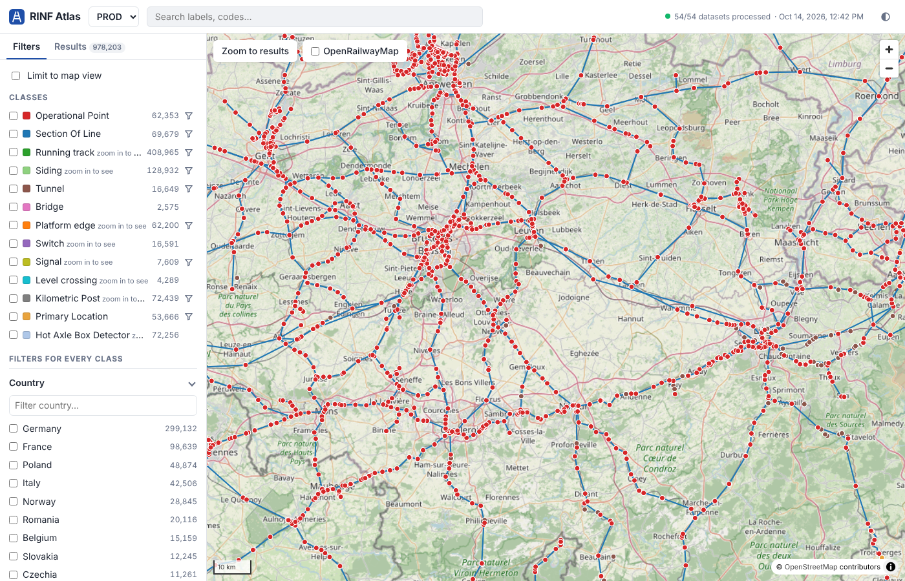

# RINF Atlas

[](https://github.com/Matdata-eu/rinf-atlas/actions/workflows/ci.yml)
[](https://github.com/Matdata-eu/rinf-atlas/pkgs/container/rinf-atlas-web)
[](LICENSE)

A fast map + faceted search over ERA's Register of Infrastructure (RINF), for
every subclass of `era:InfrastructureElement` (operational points, sections of
line, tracks, sidings, tunnels, platforms, kilometric posts, ...), with PROD
and UAT side by side.

**Demo:** https://rinf-atlas.matdata.eu. It runs on a home
server and is hosted on a best-effort basis, so expect occasional downtime.

Documentation: [how datasets are updated](docs/datasets.md),
[architecture](docs/architecture.md), [HTTP API](docs/api.md),
[shareable links](docs/urls.md), [design notes](docs/DESIGN.md),
[extra map layers](docs/layers.md), [privacy statement](docs/privacy.md).



What you can do with it:

- **Search and filter** every class at once, with facets defined in SHACL
  (below), and see the matches on one map; limit to the map view or to one
  dataset.
- **Colour the map** by any facet (maximum speed, electrification, ...) with a
  legend whose entries can be hidden.
- **Line profile**: lay a national line, a series of sections of line picked
  on the map, or the route between two operational points out as a strip along
  the distance, with one row per parameter of their tracks (maximum speed,
  electrification, gauge, ETCS level, gauging, line category...; rows are
  configurable), linked to the map and downloadable as CSV.
- **Vehicle check**: fill in a vehicle profile and see which sections of line
  it is compatible with, with an explanation per track.
- **Data quality**: every dataset is validated against ERA's SHACL shapes;
  features with issues can be shown on the map.
- **Export** the results as CSV, Excel or Turtle, or open them in a desktop
  GIS ([Use in QGIS](#use-in-qgis)).
- **Describe live** and a graph view of any element, straight from ERA.
- **Share** any view as a link ([docs/urls.md](docs/urls.md)). The **?** button
  opens an in-app guide.

Search and the map never query ERA live: a worker mirrors the RINF named
graphs and indexes them into PostGIS. Only "describe" (and the graph
traversal built on it) goes to ERA's SPARQL endpoint.

```
ERA dataset explorer API ──┐                      ┌── web (nginx + MapLibre UI) :8080
ERA GraphDB (rinf-plus) ───┼─> worker ─> PostGIS ─┤
                           │   (Oxigraph mirror)  └── api (FastAPI: facets, search, MVT tiles)
                           └──────────── live describe only ──────────┘
```

## Run it

With the published images (amd64 and arm64, from GitHub Container Registry):

```sh
cp .env.example .env        # optional: port, password, environments, graph subset
docker compose pull
docker compose up -d
docker compose logs -f worker
```

Or build from source with `docker compose up -d --build`. Set `ATLAS_VERSION`
in `.env` to pin a release (for example `1.3.1`, or `1.3` for its latest
patch) instead of `latest`.

Open `http://<host>:8080`. The first sync downloads every provider graph of
PROD and UAT (about 40 M and 27 M triples; the largest are DB InfraGO and
SNCF Réseau). Measured on a 4-core test box: all of PROD (61 graphs, 969k
features) took 34 minutes, then UAT follows; the map fills in as graphs land. To try it on a
few countries first, set for example `ATLAS_ONLY_GRAPHS=0088,0084,0082`
(Infrabel, ProRail, CFL) in `.env`.

Disk, measured for PROD: 7.6 GB mirror volume and 3.1 GB PostGIS; plan for
about 15 GB + 6 GB with UAT too, plus 2 GB of temporary space while the
largest graph downloads. RAM: 4 GB is comfortable.

Measured API timings on full PROD: unfiltered or repeated facet requests
50-200 ms, the first request for a new heavily filtered state 1-3.5 s, search
about 80 ms, vector tiles 80-600 ms.

## How new data is picked up

Users see what the backend has processed in the **Datasets** dialog (the
"54/54 datasets processed" button top right): every dataset per
environment with its infrastructure manager, country, file name, publication
date, status (processed, processing, waiting, failed with the error, removed),
feature and triple counts and when it was processed, plus when the worker last
checked for new datasets. "Show on map" limits the map and facets to that
dataset (shareable via the URL).

Every `poll_interval_minutes` (default 30) the worker, per environment:

1. reads the dataset explorer API
   (`{datasets_api}/dataset/published?latest=true&groupBy=im`, the same call
   the explorer page makes) for the latest dataset per infrastructure manager;
2. lists the repository's named graphs (`/contexts`); provider data lives in
   `http://data.europa.eu/949/graph/{IM code}`;
3. fingerprints each graph as *dataset id | publication date | triple count*
   and only re-downloads graphs whose fingerprint changed (one streaming
   N-Triples export per graph via the RDF4J `/statements` endpoint);
4. replaces the graph in the local mirror, re-extracts its features, and
   derives missing geometry; graphs that disappeared are removed;
5. validates changed graphs against the SHACL shapes ERA publishes
   (`graph/rinf/shacl`). The Datasets dialog shows the violations and warnings
   per dataset, the map can ring features with issues, a feature's details
   list its results, and each report downloads as a standard
   `sh:ValidationReport` to explore in
   [shacl-report](https://github.com/Matdata-eu/shacl-report). See
   [docs/datasets.md](docs/datasets.md#data-quality).

## Facets are SHACL you own

`shapes/*.ttl` holds one SHACL node shape per class, plus `shared.ttl` for
facets every class has (country, infrastructure manager). They were generated
from the ERA ontology and the real data (properties used by fewer than 10
instances were left out) and are meant to be edited:

```turtle
shape:operational-point a sh:NodeShape ;
    atlas:key "operational-point" ;
    sh:targetClass era:OperationalPoint ;
    atlas:geometryPath [ sh:alternativePath ( ( era:netReference gsp:hasGeometry gsp:asWKT )
                                              ( gsp:hasGeometry gsp:asWKT ) ) ] ;
    sh:property [
        sh:path era:opType ;            # any SHACL path: sequence, inverse, alternative, *, +, ?
        atlas:facet "opType" ;
        rdfs:label "Type of operational point" ;
        atlas:kind "terms" ;            # terms | range | boolean | text (search only) | link
        sh:order 50 ;
    ] .
```

All annotations are documented in `shapes/atlas.ttl`. The worker notices a
changed shape set on its next loop (within a minute) and re-indexes from the
local mirror; nothing is downloaded again (full PROD: about 20 minutes). Invalid shapes are logged and the
current index is kept.

Geometry comes from `atlas:geometryPath`; features without their own
geometry get one from linked features: `atlas:lineBetween (era:opStart
era:opEnd)` for sections of line, `atlas:geometryFrom` (for tracks: the
operational point or section of line they are part of; platforms: their
track; and so on, resolved in chains).

## Use in QGIS

Atlas layers load straight into a desktop GIS as OGC API – Features (one
layer per class, with every facet as an attribute; a class that mixes
geometry types, such as operational points with points and polygons, is one
layer per type: `prod.operational-point.point`, `prod.operational-point.polygon`,
and a feature with both a point and a polygon is in each layer with that part)
and as vector tiles. On the
demo:

| | URL |
|---|---|
| OGC API – Features | `https://rinf-atlas.matdata.eu/api/ogc` |
| One class as GeoJSON | `https://rinf-atlas.matdata.eu/api/ogc/collections/prod.tunnel/items?limit=1000` |
| Vector tiles | `https://rinf-atlas.matdata.eu/api/tiles/{z}/{x}/{y}.pbf?state=eyJlbnYiOiJwcm9kIn0` |
| Vector tile style | `https://rinf-atlas.matdata.eu/api/style.json?env=prod` (TileJSON: `/api/tiles.json?env=prod`) |

- **Features:** Layer › Add Layer › Add WFS / OGC API – Features Layer ›
  New, paste the URL, Connect, pick the classes. QGIS fetches what is in view,
  page by page. ArcGIS Pro: Insert › Connections › Server › New OGC API
  Server. GDAL: `ogrinfo OAPIF:https://rinf-atlas.matdata.eu/api/ogc`.
- **Filtered:** in the app, choose classes and filters, open Results and
  click **Open in GIS**; it copies an `/api/ogc/filtered/...` URL that serves
  only what matches. Items also take the facets as query parameters, e.g.
  `.../prod.tunnel/items?lengthOfTunnel=1000..&country=http://publications.europa.eu/resource/authority/country/BEL`.
- **Vector tiles:** Layer › Add Layer › Add Vector Tile Layer › New Generic
  Connection, the tiles URL as URL (max zoom 14) and the style URL as Style
  URL for the map's class colours. Fast for a whole country, but tiles carry
  only `id, iri, class, label, qa` (and below zoom 8 only `id, class, qa`;
  `qa` is the worst data quality severity).

Details and limits: [docs/api.md](docs/api.md#gis-access-ogc-api--features-vector-tiles).

## Commands

Run inside the worker container (`docker compose exec worker atlas ...`).
While the poll loop runs it owns the mirror, so these are queued and picked
up by the loop (`--now` runs `sync`, `reindex`, `generate-shapes` or
`validate` in the calling process instead):

| Command | What it does |
|---|---|
| `atlas sync [--env prod] [--force]` | poll now; `--force` re-downloads everything |
| `atlas reindex [--env prod]` | re-extract from the mirror (also automatic on shape changes) |
| `atlas validate [--env prod] [--graph G] [--force]` | data quality: validate graphs against ERA's SHACL shapes (automatic after a sync) |
| `atlas shapes-tags [--env prod]` | list the ERA ontology tags `quality.shapes_tag` can pin the shapes to |
| `atlas generate-shapes [--force] [--no-data]` | regenerate starter shapes into `shapes/` (keeps existing files unless `--force`) |
| `atlas check-shapes [-v]` | parse `shapes/` and print the compiled facets |
| `atlas load-file --env prod --graph IRI file.nt` | index a local file (testing; stop the worker first) |

## Configuration

`config/environments.yaml` lists the environments (SPARQL repository,
dataset explorer API, vocabulary graphs) and the provider-graph pattern.
The `quality:` block there (and `ATLAS_QUALITY*` in `.env`) tunes or turns
off the data quality validation, per environment if needed: which SHACL
shapes (ERA's published graph, or a pinned tag of ERA's ontology repository
such as `v3.3.4`) and the largest dataset to validate (15M triples by
default).

`.env` (start from `.env.example`) sets:

| Variable | Default | |
|---|---|---|
| `ATLAS_PORT` | `8080` | host port of the web UI |
| `POSTGRES_PASSWORD` | `atlas` | database password; change it |
| `PG_SHARED_BUFFERS` | `1GB` | PostgreSQL `shared_buffers` |
| `ATLAS_ENVS` | all | environments to index and serve (`prod,uat`) |
| `ATLAS_ONLY_GRAPHS` | all | graphs to index (IM codes like `0088,0084` or graph IRIs) |
| `ATLAS_POLL_MINUTES` | `30` | how often the worker checks for new datasets |
| `ATLAS_PUBLIC_URL` | from the request | public address behind a TLS proxy (e.g. `https://rinf-atlas.example.org`), used in the OGC API and TileJSON links |
| `ATLAS_TTL_EXPORT_MAX` | `20000` | most entities in one Turtle export (fetched live from ERA) |
| `ATLAS_QUALITY` | `1` | `0` turns data quality validation off |
| `ATLAS_QUALITY_MAX_TRIPLES`, `ATLAS_QUALITY_MINUTES`, `ATLAS_QUALITY_SHAPES_TAG` | `environments.yaml` | size limit, time budget per dataset and pinned shapes tag; one value or `prod=…,uat=…` ([docs/datasets.md](docs/datasets.md#data-quality)) |
| `ATLAS_SHACL_REPORT_URL` | `https://shacl-report.matdata.eu/` | shacl-report instance the UI links to (empty = no link) |
| `ATLAS_LAYER_*` | | keys of the extra map layers ([docs/layers.md](docs/layers.md)) |
| `ATLAS_IMAGE`, `ATLAS_VERSION` | `ghcr.io/matdata-eu/rinf-atlas`, `latest` | published images to run |

The `api` container also reads `.env` itself, so these API tuning knobs can
be set there too: `ATLAS_TERMS_LIMIT` (200 values per terms facet),
`ATLAS_TILE_CACHE_SECONDS` (300), `ATLAS_TILE_MAXZOOM` (14),
`ATLAS_LOW_DETAIL_ZOOM` (8), `ATLAS_PROFILE_MAX_SECTIONS` (3000),
`ATLAS_DB_POOL` (10), `ATLAS_FACET_THREADS` (4) and the OGC API limits
`ATLAS_OGC_DEFAULT_LIMIT`, `ATLAS_OGC_MAX_LIMIT`, `ATLAS_OGC_MAX_OFFSET`,
`ATLAS_OGC_TIMEOUT_MS` ([docs/api.md](docs/api.md#gis-access-ogc-api--features-vector-tiles)).

To publish a privacy statement for your instance, put a page at
`site/privacy.html` (start from `site/privacy.example.html`); the app then
links it as **Privacy**. [docs/privacy.md](docs/privacy.md) explains how and
lists what the app processes, as a basis for what to disclose.

To add your own map layers (aerial photos, a WMS, vector tiles, including
private ones that need an API key), list them in `config/layers.yaml` (start
from `config/layers.example.yaml`); they appear in the **Map layers** menu.
Keys go in `.env` and stay on the server: the API proxies those tiles.
[docs/layers.md](docs/layers.md) explains how and the trade-offs.

Search engines are asked not to index an instance until `ATLAS_PUBLIC_URL` is
set; then it gets a canonical address, link previews, `robots.txt` and a
sitemap. [docs/seo.md](docs/seo.md) lists what the app does and the steps
that remain for a public instance (domain, redirects, Search Console).

## Layout

| Path | |
|---|---|
| `worker/` | ingest worker (`atlas` CLI): discovery, Oxigraph mirror, SHACL-driven extraction, shape generator |
| `api/` | FastAPI app: facets, search, extent, vector tiles (`ST_AsMVT`), feature, export, OGC API – Features, live describe |
| `web/` | TypeScript + MapLibre + vis-network frontend (built into the nginx image) |
| `shapes/` | facet shapes (edit these) |
| `config/` | `environments.yaml` (environments, data quality), `layers.example.yaml` (extra map layers) |
| `site/` | optional pages for your instance, such as `privacy.html` |
| `db/init.sql` | PostGIS schema |
| `tests/` | `smoke.sh` end-to-end test and its sample data in `fixtures/` |
| `scripts/` | `check-commits.sh` (Conventional Commits check) |
| `third_party/` | licences of third-party material (ERA ontology and shapes) |
| `docs/api.md` | HTTP API contract |
| `docs/urls.md` | shareable links: the URL scheme of the web app |
| `docs/datasets.md` | how datasets are updated |
| `docs/architecture.md` | architecture overview |
| `docs/DESIGN.md` | design notes |
| `docs/privacy.md` | adding a privacy statement; what the app processes |
| `docs/layers.md` | adding your own map layers, with API keys |
| `docs/seo.md` | search engines and link previews; steps for a public instance |

## Feedback

Bugs, feature requests and questions: [open an issue](https://github.com/Matdata-eu/rinf-atlas/issues/new/choose).
The web app links here from its About dialog (the ⓘ button at the top right).

## Development

See [CONTRIBUTING.md](CONTRIBUTING.md): the frontend runs against a bundled
mock API, and `tests/smoke.sh` indexes a small Luxembourg sample
(`tests/fixtures/`) into a running stack and checks every endpoint, after which
the Playwright tests in `web/e2e/` drive the UI in a browser at desktop and
phone sizes. CI runs lint, tests, the frontend build and both end-to-end
suites; pushes to `main` and version tags publish the images.

## Licence and data

Code: [MIT](LICENSE). The MIT licence covers this repository's code only, not
the data the app shows or the services it loads at runtime:

- **RINF data** comes from the European Union Agency for Railways' Register of
  Infrastructure (RINF). ERA publishes it because EU law requires it
  (Directive (EU) 2016/797, Regulation (EU) 2019/777). The infrastructure
  managers who submit it remain responsible for it, and ERA's
  [RINF terms of use](https://www.era.europa.eu/system/files/2022-11/rinf_terms_of_use_en.pdf)
  apply. No data is stored in this repository except the small test extracts in
  `tests/fixtures/`, which credit their sources. This project is not affiliated
  with ERA.
- **ERA vocabulary**: the facet shapes in `shapes/` use class and property IRIs
  and labels from the [ERA ontology](https://data-interop.era.europa.eu/era-vocabulary/)
  (EUPL 1.2).
- **Basemap**: raster tiles from the [OpenStreetMap](https://www.openstreetmap.org/copyright)
  tile server (data © OpenStreetMap contributors, ODbL). The servers are
  donated, so follow the [tile usage policy](https://operations.osmfoundation.org/policies/tiles/):
  a busy deployment should point at its own or a commercial tile server.
- **Rail overlay** (optional): [OpenRailwayMap](https://www.openrailwaymap.org/) tiles
  (CC-BY-SA 2.0, data ODbL), free only for small, public, non-commercial use
  ([conditions](https://wiki.openstreetmap.org/wiki/OpenRailwayMap/API)).
- **ERA SHACL shapes** (the data quality rules), © ERA, are licensed under the
  [EUPL 1.2](third_party/era-ontology/LICENSE), as the shapes and ERA's
  [ontology repository](https://gitlab.com/era-europa-eu/public/interoperable-data-programme/era-ontology/era-ontology)
  state. The worker mirrors them from ERA's repository like the data, or, when
  `quality.shapes_tag` is set, downloads them from that GitLab repository at
  the tag (same licence) into its cache; they are not part of the images.
  `tests/fixtures/era-shacl.nt.gz` is an unmodified copy for the tests,
  credited in [tests/fixtures/README.md](tests/fixtures/README.md).
- **shacl-report**: the worker image includes the
  [shacl-report](https://github.com/Matdata-eu/shacl-report) 1.0.0 binary
  (Apache-2.0, by Mathias Vanden Auweele) to render the reports; its `LICENSE`
  and `THIRD_PARTY_NOTICES.md` (the licences of the libraries compiled into it
  and embedded in its HTML reports, all permissive) ship with it in the image
  under `/usr/share/licenses/shacl-report/`.
- **Dependencies** are under permissive licences (MIT, BSD, ISC, Apache-2.0)
  or weak copyleft used unmodified: psycopg (LGPL-3.0) and, at build time only,
  lightningcss (MPL-2.0). The PostGIS image (GPL-2.0) runs as an unmodified,
  separate container.
