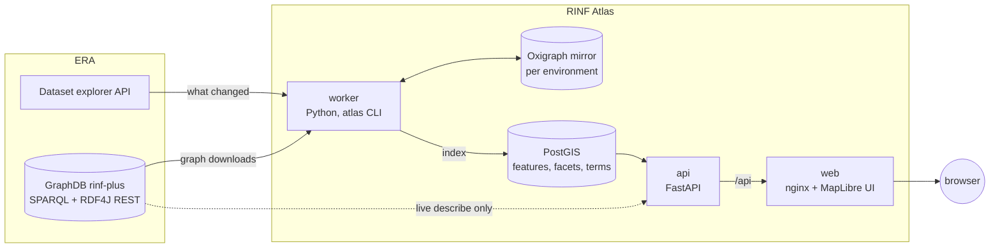

# Architecture

RINF Atlas is four containers started by one `docker-compose.yml`.

| Service | Technology | Role |
|---|---|---|
| `db` | PostgreSQL 16 + PostGIS 3.4 | The index: one row per infrastructure element with its geometry (EPSG:4326 plus a pre-projected EPSG:3857 copy for tiles), facet values as `jsonb`, a full-text `tsvector`; labels of IRI values; dataset status. |
| `worker` | Python 3.14, pyoxigraph, psycopg | Polls ERA, mirrors changed named graphs in an embedded Oxigraph store per environment, indexes them into PostGIS and validates them against ERA's SHACL shapes. See [datasets.md](datasets.md). With the optional describe index on, it also stores every triple and one precomputed page per resource for [RINF Describe](https://github.com/Matdata-eu/rinf-describe), which reads them from the same database ([describe.md](describe.md)). |
| `api` | Python 3.14, FastAPI, uvicorn | Facet counts, search, extent, vector tiles (`ST_AsMVT` straight from PostGIS), map colouring, feature details, dataset status and data quality, exports, line profiles, the vehicle check, OGC API – Features, the proxy for extra map layers, and the live describe proxy to ERA. Contract: [api.md](api.md). |
| `web` | TypeScript, Vite, MapLibre GL JS, vis-network, nginx | The single-page UI; nginx serves the build and proxies `/api/` to the api service. |

## Key design choices

- **No live ERA queries for search or the map.** ERA's endpoint is too slow
  for interactive faceting over about a million elements, so everything comes
  from the local index. Only describing one entity goes live.
- **Facets are SHACL.** `shapes/*.ttl` holds one node shape per
  `era:InfrastructureElement` subclass, with property paths annotated as
  facets (`terms`, `range`, `boolean`, `text`, `link`). The worker compiles them to
  SPARQL against the mirror; the API and UI only see the compiled facet list.
  Starter shapes were generated from the ontology and the data.
- **A local RDF mirror.** Keeping every graph in Oxigraph means a shape
  change re-indexes without downloading anything, and extraction can use
  full SPARQL paths.
- **Facet semantics.** Shared facets (country, infrastructure manager) apply
  to every class. A class's own facets are scoped to that class
  (`class/key`), so filtering operational points leaves other classes alone.
  Counts for a facet ignore that facet's own selection (multi-select).
- **Speed.** Unfiltered facet counts are precomputed after each update;
  filtered ones run as parallel SQL queries over GIN indexes and are cached
  per data version. Vector tiles carry only id, class and data quality
  severity below zoom 8, and detailed classes (tracks, signals, kilometric
  posts…) appear from a per-class minimum zoom (unless the user draws a class
  at every zoom).
- **Only what ERA's SPARQL needs goes live.** Describe, the graph view
  and the Turtle export query ERA from the api container; the browser never
  talks to ERA.
- **Environments side by side.** PROD and UAT share one database, tagged by
  environment; the UI switches between them.

Measured on all of PROD (61 graphs, about 970,000 elements): first load 34
minutes, 7.6 GB mirror and 3.1 GB PostGIS; facet counts 50-200 ms
(1-3.5 s for a new heavily filtered combination), search about 80 ms, tiles
80-600 ms.

More detail: [DESIGN.md](DESIGN.md).
